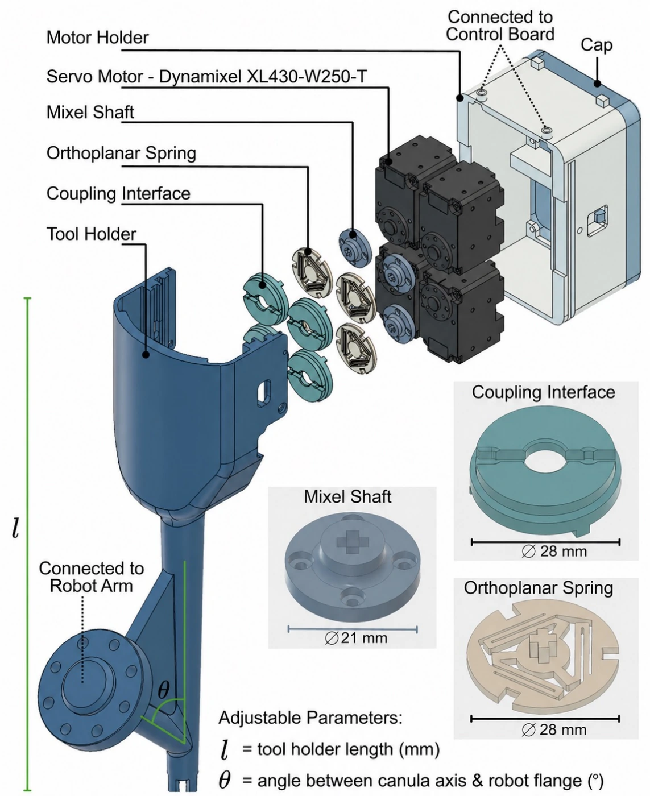

# SuMI — Surgical Manipulation Interface

**Zero-Shot Policy Transfer between Different Robots with Wristed Instruments for Minimally Invasive Surgery**

SuMI equips serial robot arms with da Vinci EndoWrist instruments. A modular actuation unit and remote-center-of-motion (RCM) controller align the tool interface and constrained motion with a surgical robot, enabling policy learning on Franka SuMI and zero-shot deployment on the da Vinci Research Kit (dVRK).

[Project website](https://medcvr.utm.utoronto.ca/SuMI.html) · [Paper](https://medcvr.utm.utoronto.ca/assets/projects/SuMI/paper/sumi.pdf) · [CAD files](#cad-files) · [Print settings](#print-settings) · [Citation](CITATION.bib)

## Hardware

The actuation unit uses four servo motors, printed dial couplings and compliant springs, and an adjustable tool holder. The holder length **l** (mm) and angle **θ** (degrees, between the cannula axis and robot flange) can be adapted to the robot and task.

*SuMI actuation unit.*

## CAD files

All six components are available as STEP models in [`cad/step/`](cad/step/) for CAD editing and STL meshes in [`cad/stl/`](cad/stl/) for printing. Use millimeters when importing the STL files into your slicer.

| Component | CAD model | Print mesh |
| --- | --- | --- |
| Tool holder — Franka, **l = 290 mm**, **θ = 45°** | [tool_holder_290mm+45deg+franka.step](cad/step/tool_holder_290mm+45deg+franka.step) | [tool_holder_290mm+45deg+franka.stl](cad/stl/tool_holder_290mm+45deg+franka.stl) |
| Coupling interface | [coupling_interface.step](cad/step/coupling_interface.step) | [coupling_interface.stl](cad/stl/coupling_interface.stl) |
| Orthoplanar spring | [orthoplanar_spring.step](cad/step/orthoplanar_spring.step) | [orthoplanar_spring.stl](cad/stl/orthoplanar_spring.stl) |
| Mixel shaft | [mixel_shaft.step](cad/step/mixel_shaft.step) | [mixel_shaft.stl](cad/stl/mixel_shaft.stl) |
| Motor holder | [motor_holder.step](cad/step/motor_holder.step) | [motor_holder.stl](cad/stl/motor_holder.stl) |
| Motor cover (cap) | [motor_cover.step](cad/step/motor_cover.step) | [motor_cover.stl](cad/stl/motor_cover.stl) |

The provided tool holder mounts to a Franka arm. Using a different serial arm requires editing the mounting piece on the tool holder to match that robot's flange. Use the tool holder's STEP file to make this change.

Controller code and datasets are not included yet.

## Bill of materials

The following estimate is in USD. It is a reference budget, not a current supplier quotation.

| Component | Quantity | Unit price (USD) | Subtotal (USD) |
| --- | ---: | ---: | ---: |
| DYNAMIXEL XL430-W250-T | 4 | $23.90 | $95.60 |
| U2D2 Board | 1 | $36.90 | $36.90 |
| U2D2 Power Hub Board | 1 | $19.00 | $19.00 |
| PLA filament | 0.240 kg | $30.00 / kg | $7.20 |
| **Total** | | | **$158.70** |

The estimate excludes the robot arm and EndoWrist instrument. 

## Print settings

| Setting | Reported value |
| --- | --- |
| Process | Fused deposition modeling (FDM) |
| Printer Used | Bambu Lab H2D |
| Material | PLA |
| Nozzle diameter | 0.4 mm |
| Layer height | 0.2 mm |
| Infill | 25% |
| Supports | Tree supports |
| Tool-holder orientation | Vertical |

Print the tool holder vertically to preserve the concentricity and diameter of the internal cannula.

## Coming soon

- Assembly guide.
- RCM controller that is generic for different serial arms other than Franka.
- Link to downloadable adjustable tool-holder design with configurable **l** and **θ**.

## Design references

[Project-Salai](https://github.com/bennettstirton/Project-Salai) for the coupling interface and [Sutton et al., *Ultra-Compact Orthoplanar Spring via Euler-Spiral Flexures*](https://doi.org/10.3390/machines12040273) for the orthoplanar spring design.

## Citation

If you use SuMI in your research, please cite our work using [`CITATION.bib`](CITATION.bib). The citation uses the paper title, author list, year, and project URL.
